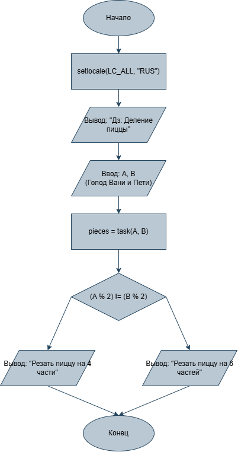

# Домашнее задание к работе 4

## Условие задачи
3. Дележка пиццы
Друзья заказали пиццу. Они решат, резать ее на 4 или 6 кусков, по простому правилу: если ровно один из них (Ваня A или Петя B) проголодался (его "уровень голода" - четное число), то резать на 4 части. Запишите условие для нарезки на 4 части.

## 1. Алгоритм и блок-схема

### Алгоритм
1. **Начало**
2. Подключить необходимые библиотеки:
	• <stdio.h> — для ввода/вывода данных (printf, scanf).
	• <stdlib.h> — стандартные функции библиотеки.
	• <locale.h> — для настройки локали (поддержка корректного отображения символов).
3. Объявить прототип функции task(), которая не принимает аргументов и возвращает целое число.
4. Определить функцию main() — главную точку входа в программу:
	• Установить кодировку UTF-8 для корректного отображения кириллицы: setlocale(LC_ALL, ".UTF8").
	• Вызвать функцию task() для выполнения основной логики программы.
	• Вернуть значение 0 (успешное завершение программы).
5. Определить функцию task():
	• Объявить целочисленные переменные A и B для хранения уровня голода Вани и Пети.
	• Вывести на экран заголовок «Дз: Деление пиццы».
	• Запросить у пользователя ввод значения для Вани (A) и считать его с помощью scanf.
	• Запросить у пользователя ввод значения для Пети (B) и считать его с помощью scanf.
	• Объявить логическую переменную vhunger и записать в неё результат проверки: является ли число A чётным (A % 2 == 0).
	• Объявить логическую переменную phunger и записать в неё результат проверки: является ли число B чётным (B % 2 == 0).
	• Проверить условие (vhunger != phunger): если четность уровней голода Вани и Пети различается (один чётен, а другой нечётен):
		• Вывести на экран сообщение: «Резать пиццу на 4 части.».
	• Иначе (если оба чётные или оба нечётные):
		• Вывести на экран сообщение: «Резать пиццу на 6 частей.».
	• Вернуть значение 0 из функции task() (успешное завершение работы функции).
6. **Конец**

### Блок-схема
 

https://github.com/stzraw/lab-4-VSTU-HW/blob/main/lab_4_schema.png

## 2. Реализация программы

#include <stdio.h>
#include <stdlib.h>
#include <locale.h>

int task(void);

int main(void) {
    setlocale(LC_ALL, ".UTF8");
    task();
    return 0;
}

int task(void)
{
    int A, B;
    printf("Дз: Деление пиццы\n");
    printf("Насколько голоден Ваня (A): ");
    scanf("%d", &A);
    printf("Насколько голоден Петя (B): ");
    scanf("%d", &B);

    int vhunger = (A % 2 == 0);
    int phunger = (B % 2 == 0);

    if (vhunger != phunger) {
        printf("Резать пиццу на 4 части.\n");
    } else {
        printf("Резать пиццу на 6 частей.\n");
    }
    return 0; 
}

## 3. Результаты работы программы

Дз: Деление пиццы
Насколько голоден Ваня (A): 80
Насколько голоден Петя (B): 33
Резать пиццу на 4 части.

или

Дз: Деление пиццы
Насколько голоден Ваня (A): 80
Насколько голоден Петя (B): 22
Резать пиццу на 6 частей.

## 4. Информация о разработчике

Быханов Александр Андреевич бИД - 262 2пг

