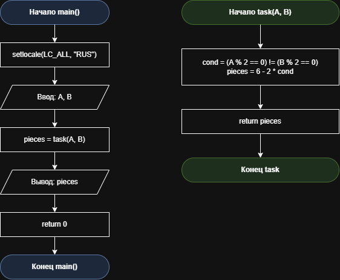

# Домашнее задание к работе 4

## Условие задачи
3. Дележка пиццы
Друзья заказали пиццу. Они решат, резать ее на 4 или 6 кусков, по простому правилу: если ровно один из них (Ваня A или Петя B) проголодался (его "уровень голода" - четное число), то резать на 4 части. Запишите условие для нарезки на 4 части.

## 1. Алгоритм и блок-схема

### **Алгоритм**
1. **Начало**
2. Подключить необходимые библиотеки:
   - `<locale.h>` - для работы с локалью (поддержка русского языка).
   - `<stdio.h>` - для ввода и вывода данных (printf, scanf).
   - `<stdlib.h>` - стандартные библиотечные функции.
3. Объявить прототип функции `int task(int A, int B)` для расчёта количества кусков пиццы.
4. Определить функцию `main()` - точку входа в программу:
   - Объявить целочисленные переменные типа int: `A` (голод Вани), `B` (голод Пети), `pieces` (число кусков).
   - Установить локаль для корректного отображения кириллицы: `setlocale(LC_ALL, "RUS")`.
5. Запросить у пользователя и считать с клавиатуры значения уровней голода `A` и `B` с помощью функции `scanf`.
6. Вызвать функцию `task(A, B)`, передав ей значения `A` и `B` в качестве аргументов.
7. В теле функции `task(int A, int B)`:
   - Объявить переменные типа int: `cond` (условие нарезки) и `pieces` (количество кусков).
   - Вычислить логическое условие нарезки на 4 части (ровно один уровень голода чётный): `cond = (A % 2 == 0) != (B % 2 == 0)`.
   - Рассчитать количество кусков с помощью линейной арифметической формулы: `pieces = 6 - 2 * cond`.
   - Вернуть вычисленное значение `pieces` в вызывающую функцию `main()`.
8. В функции `main()` сохранить результат вызова в переменную `pieces`.
9. Вывести на экран итоговое количество кусков пиццы с помощью `printf` и завершить программу, вернув 0.
10. **Конец**

### Блок-схема
 

[https://github.com/stzraw/lab-4-VSTU-HW/blob/main/lab_4_schema.png](https://github.com/stzraw/lab-4-VSTU-HW/blob/main/lab_4_schema.pravki.png)

## 2. Реализация программы

#define _CRT_SECURE_NO_DEPRECATE
#include <stdio.h>
#include <stdlib.h>
#include <locale.h>

int task(int A, int B);

int main()
{
    int A, B, pieces;

    setlocale(LC_ALL, "RUS");

    printf("Дз: Деление пиццы\n");
    printf("Насколько голоден Ваня (A): ");
    scanf("%d", &A);
    printf("Насколько голоден Петя (B): ");
    scanf("%d", &B);

    pieces = task(A, B);
    printf("Резать пиццу на %d кусков\n", pieces);
    return 0;
}

int task(int A, int B)
{
    int cond;
    int pieces;

    cond = (A % 2 == 0) != (B % 2 == 0);
    pieces = 6 - 2 * cond;
    return pieces;
}

## 3. Результаты работы программы

Дз: Деление пиццы
Насколько голоден Ваня (A): 4
Насколько голоден Петя (B): 3
Резать пиццу на 4 кусков

или

Дз: Деление пиццы
Насколько голоден Ваня (A): 2
Насколько голоден Петя (B): 4
Резать пиццу на 6 кусков

или

Дз: Деление пиццы
Насколько голоден Ваня (A): 3
Насколько голоден Петя (B): 5
Резать пиццу на 6 кусков

## 4. Информация о разработчике

Быханов Александр Андреевич бИД - 262 2пг

